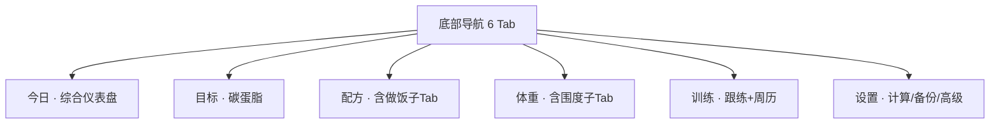
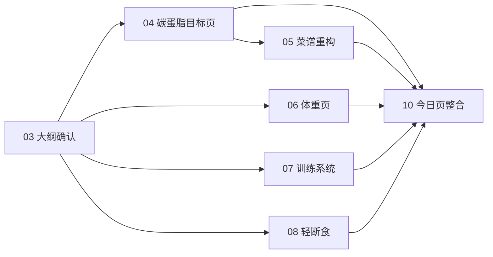

# 方案设计-方案大纲-v1

> 阶段：方案设计 | 日期：2026-11-24
> 输入：docs/需求澄清-第二轮纪要-v1.md + 调研问卷 v1 作答（61/63）
> 状态：待出卡确认；确认前不进入任何模块详设。

## 1. 目标与范围

健身助手二次开发，按用户 Top3 优先级推进 6 个实施模块 + 1 个评估报告，对应计划表 10 项（01/02 已收口）：

| 计划项 | 一句话范围 |
|---|---|
| 04-碳蛋脂目标页 | 新独立页：目标 vs 已吃差额条，日型自动推断+手动改，休息日自动调比，联动配方生成 |
| 05-菜谱交互重构 | 三段式固定结构 + 搜索/常用/品类找食物 + 反馈体系（toast+震动），做饭并入子 Tab |
| 06-独立体重页 | 体重/体脂率/腰围 + 围度子 Tab（6 部位），曲线三视图+目标虚线，悬浮大按钮 |
| 07-训练系统升级 | 跟练感训练页（大 GIF+倒计时+1 次点击记组）+ 周历一键排课 + 动作库 SQLite 化（哑铃+凳+自重） |
| 08-轻断食计时 | 16:8 手动开关 + 第一餐回推兜底，今日页卡片入口，页内提示 |
| 10-今日页整合 | 综合仪表盘：饮食/训练/体重/断食卡片聚合，修复 Tab 遮挡 |
| 09-手表评估报告 | 只评估不实施：PWA+Web Push 路线可行性成文，出卡裁决是否立项 |

## 2. 导航结构（6 Tab）

- **做饭**并入配方页子 Tab（第二轮 Q1 裁决），做饭页去掉称重引导 UI，生熟重换算保留在配方数据层。
- **原「记录」页取消独立 Tab**（唯一超出问卷字面答案的结构决策）：历史数据按域归并——体重/围度曲线归体重页、训练/有氧历史归训练页、饮食历史归今日页历史区；数据一条不丢，只换归属。此点需在确认卡上明示。

## 3. 模块依赖与执行顺序

执行顺序：**04 → 05 → 06 → 07 → 08 → 10 → 09**（06 与 04 后的并行窗口可穿插）。节奏遵循用户要求：每完成一个模块即交付试用、收集意见再进下一个。

## 4. 各模块关键设计决策（来源：第二轮纪要）

- **04**：已吃=按当日配方锁定份量折算，未生成配方显示「未记录」；日型=自动推断+手动覆盖写 `day_logs.day_type`；底层保留 7 槽、入口呈现 4 类；练后餐比例进高级设置；不做速查小抄。
- **05**：固定三段式（目标卡/配方区/底部操作条）；找食物=搜索置顶+常用 20 快捷片（最近用过排最前）+品类分层兜底；加一份菜=1 步；生成引擎不动只换交互外壳。
- **06**：悬浮大按钮记录、当日后值覆盖；曲线=近 30 天/全部/7 日均线+目标虚线；进度低调（只画目标线）；围度=腰/臀/大臂左右/大腿左右；提醒搬体重页为主、今日页轻提示。
- **07**：跟练感=大 GIF+组间倒计时（时长可配）+记一组 1 次点击（默认推荐重量次数直接确认）；字段 reps+weight+RIR；周历一键生成一周排课（输入目标+天数）+手动拖改+当天没练顺延；动作库入 SQLite 可增删改随备份，ExerciseDB 筛选边界=哑铃+凳+自重（约 300+）；既有 19 动作 key 铁律不变；A/B/C 多课表并存可切换。
- **08**：16:8 手动开始/结束为主，忘点按当日第一餐打卡时间自动回推兜底；今日页小卡片；只做页内提示、不做推送。
- **10**：仪表盘聚合四类卡片；修复「页面会动 + Tab 遮挡」=全局 safe-area + 底部操作区避让 Tab 栏。
- **09**：调研结论已入纪要（PWA+Web Push 自 iOS 16.4 可行且镜像手表、Web Bluetooth 不可行、快捷指令兜底）；报告只补成本/限制清单，立项另出卡。

## 5. 本轮不做（非目标）

手表端任何实施、原生 App、Mac/Xcode 路线、器械扩展（壶铃/弹力带/引体杆）、身体档案、视频订阅内容、手动已吃台账、目标页速查小抄、做饭称重引导 UI、iPhone 健康 App 深度集成。

## 6. 技术约束（沿用仓库既有铁律）

前端零新依赖（不引 UI 库/vue-router/axios）、计算层纯函数+verify 断言回归、`EXERCISES` key 只增不改、备份白名单对账、中文注释讲为什么、函数≤50 行、Windows PowerShell5+Node22 环境。

## 7. 验收节奏

每模块：verify 新增断言全绿 + 主流程跑通 → 用户真机试用提意见 → 结转下一模块。全局收尾：旧数据迁移零丢失（备份导出导入对账）。
